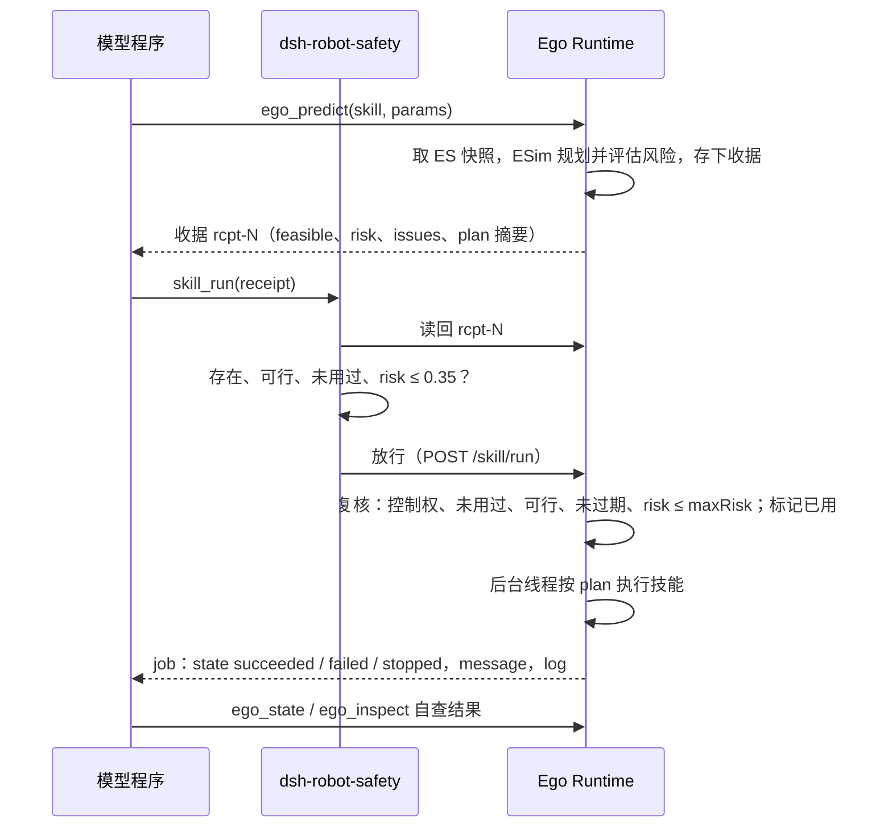

# Phase 0 工作方式：EH 如何构建 ES、完成任务与反思

本文说明 Steward 在 Phase 0 下的工作方式：Ego Harness（EH）与 Ego Runtime（ER）怎样构建 Ego State（ES），一个任务从操作员下达到完成经过哪些步骤，LLM 在其中承担哪些职责，代码生成与 reflection 怎样进行；最后用 2026-11-08 23:28 的 puzzle-dog 会话日志（`session-54f4c614`）具体说明，并整理碰到问题时的处理方法。

## 1. 总体结构


信息边界：EH 只能通过 `ctx.ego` 的工具看到 ES，看不到 World State（WS）。`cordis.patch.yml` 关掉了 bash、文件、网页等通用工具，模型只能在 `run_code` 程序里调用机器人工具。WS 只给 Observer 和 `/wca/goal` 做评估。

| 组件 | 位置 | 职责 |
|---|---|---|
| HarnessChat | `steward/src/steward/world/chat.py` | 每条操作员消息启动一个 `dsh --profile ego --json` 进程，首轮发送 `ROBOT_BRIEF`，接管和交还机器人控制权，把进度写进控制台 |
| Ego Harness 插件 | `steward/dsh/packages/` | `dsh-tool-ego`（机器人工具）、`dsh-robot-safety`（收据守卫）、`dsh-ego-reflection`（反思与推理强度）、`dsh-tool-ego-capabilities`（能力库），以及 PTC 模式（`run_code`） |
| Ego Runtime | `steward/src/steward/ego/` | `estimator.py` 维护 ES，`esim.py` 做预测与收据，`skills.py` 执行技能，`runtime.py` 对外提供 HTTP 接口 |
| WSim | `steward/src/steward/world/sim.py` | MuJoCo 物理仿真，渲染相机，生成 Phase 0 检测 |

## 2. Phase 0 是什么

Phase 0 是“理想感知”级别（`steward/src/steward/phases.py`）：WSim 不提供原始图像给估计器，而是直接给出每台相机看到的物体检测（类别、带噪声的位姿和尺寸）。`phase0-misnamed` 在此基础上按 `config/misnames.toml` 把部分类别报成混淆的名字（`box` 报成 `picture`，`table` 报成 `dinner table`），用来检验 EH 能否通过反思纠正命名。

Phase 0 的三个要点：

- **几何来自带噪声的检测。** 每个检测的位置噪声为 σ =（1 cm + 2 cm/米 × 距离）× 240 / 相机行数。头部相机是 2560×1920，1 米处每轴约 0.4 cm；广角相机是 480×360，约 2 cm。估计器使用同一个公式。
- **外观来自真实渲染。** `ego_inspect`、`ego_match_face` 和后台的顶面记忆读取 WSim 渲染的 RGB 图像，所以分辨率、距离、遮挡和相邻物体的颜色都会影响图案判断。这也是拼图需要高分辨率的原因：看不清时连正反面都分不出（第 9.4 节）。
- **抓取是理想吸附。** 夹爪在捕获半径内闭合时，WSim 把物体按它此刻的真实相对位姿固定在夹爪上。所以抓取前估计偏了多少，放下时就会偏多少，除非手中物体的偏移被修正（第 3.4 节）。

## 3. EH 怎样构建 ES

ES 由 Ego Runtime 的估计器（`EgoEstimator`）维护，EH 只读取和标注它。感知循环按 `perception_hz`（10 Hz，世界时钟）运行，每帧调用 `estimator.update(frame)`。

### 3.1 每帧的步骤

1. **读本体状态。** 读取里程计、关节编码器和夹爪状态。夹爪不再持物时清除“手持”标记，手持物体按当前关节位姿跟随夹爪（`_follow_held`）。
2. **检测转到地图坐标。** 每个检测按对应相机的位姿从相机坐标转到地图坐标，并按距离和相机行数算出测量标准差 σ。
3. **关联。** 所有“检测—轨迹”对按距离从近到远一对一分配：同一台相机的一个检测只给一条轨迹，一条轨迹每台相机最多接收一个检测。所以两台相机都看到的同一块积木只有一条轨迹，一台相机同时看到、互相压着的两块仍是两条。
4. **融合。** 位置用卡尔曼滤波融合；朝向在稳定后要连续 3 次检测都偏离 0.3 rad 以上才会跟随，防止邻块的检测把它带偏。同时累积类别分布、颜色和存在概率。
5. **新物体的物理合理性检查（`_newcomer`）。** 没有轨迹能解释的检测，只有贴近地面、落在某条轨迹或同帧另一个检测的顶面上（间隙不超过 3 cm 加两倍 σ）时才建新轨迹。悬空的检测多半正在下落，不建轨迹。落在手中容器里的检测作为容器的内容物，随容器移动。
6. **衰减、删除与合并。** 应该在视野里却没被检测到的轨迹，存在概率逐帧衰减，低于阈值就删除。手中容器里长时间看不到的内容物被删除。重复的轨迹被合并，但同一帧里同一台相机分别看到的两条不合并。

### 3.2 先验与可供性

`priors.py` 给已知类别提供可供性（`support-surface`、`graspable`、`container`、`receptacle` 等）和易碎度。不认识的类别按尺寸常识推断：落地、顶面高于 0.3 米、宽于 0.4 米的是有支撑面的家具，小于 0.35 米的可以抓取。EH 认出物体后用 `ego_annotate` 改名字或可供性，例如本次日志把感知叫作 `picture` 的盒子标为 `puzzle box`。

### 3.3 顶面外观记忆

后台的 `_face_loop` 线程按间隔对附近的小物体取顶面，存成颜色网格（`Appearance`）。`ego_inspect` 用一帧新图读取指定物体的顶面网格，并返回 `sourcePx`（顶面较短边在相机图像里的像素宽）。不足 24 像素时附带 `detailHint`，说明要走到多近。`ego_match_face` 把一组物体的顶面与参考物体（盒盖）的图案做比对，给出每块在参考图上的位置、转向和得分。

### 3.4 手中物体与放置精度

抓起物体时，`mark_held` 记下物体相对夹爪的偏移，并把位置方差至少放到 `grasp_shift_m`（1 cm）的平方。抓起后，相机对手中物体的检测会继续修正这个偏移（`_refine_held`）；离预测位置超过 `held_view_gate_m`（5 cm），或同样靠近旁边另一条轨迹的检测，不用于修正。放置松手前，技能等升降和伸缩回到设定值 2 mm 以内（最多等 0.6 秒）。这几项加上高分辨率相机，把探针测得的落点误差从 1.5–4.3 cm 降到 0.1–0.6 cm。

### 3.5 不合理物体的处理

ES 摘要里，悬空、下面没有支撑、或嵌在别的物体里的轨迹会标上 `unsupported`。`ROBOT_BRIEF` 要求 EH 先走近用 `ego_observe` 复查；位置清楚可见却一直感知不到时，用 `ego_forget` 删除它，并写明理由。估计器只允许删除已有 `forget_unseen_s`（3 秒）没被看到、且不在手中的轨迹。

### 3.6 ES 的质量评估

Observer 每帧把 ES 与 WS 对照，写入 `var/steward/runs/<run>/observer.jsonl`，包括召回率、误检数、平均和最大位置误差、类别准确率，以及 ES 轨迹到真实实体的对应关系（`matches`）。本次运行结束时，19 个物体全部匹配，没有误检，平均位置误差 2.8 mm，最大 4.8 mm。类别准确率是 89%，因为 `phase0-misnamed` 有意把类别报错。

## 4. 完成任务的基本流程

### 4.1 一轮对话

1. 操作员在控制台输入指令。HarnessChat 通过 Ego API 接管机器人（停掉当前技能，暂停后台任务），启动 `dsh --profile ego`。第一轮把 `ROBOT_BRIEF` 加在“操作员任务：”之后的指令前面，后续轮用 `--session-id` 续接同一会话。
2. 模型每一步输出一段思考和一个 `run_code` 程序。程序在持久的沙箱里运行，只能调用 `tools.*`（即机器人工具）。
3. 程序结束后，结果（打印输出或错误）连同反思插件附加的消息一起回到模型，模型再决定下一步。
4. 模型认为完成或无法完成时，用一两句中文汇报，这一轮结束，机器人控制权交还。轮次上限是 `TURN_BUDGET_S`（24 天）。

### 4.2 一个动作的执行



技能执行（`skills.py`）是确定性的控制程序，不调用 LLM。下面三小节分别说明每一步。

#### 4.2.1 `ego_predict`：只用 ES 预演一次动作

`ego_predict` 不让机器人动，只回答“如果现在做这个动作，会怎样”。模型给出技能名和参数，例如 `{skill: "place", on: "e:8", offset: [0.7, 0], yaw: 0}`。Ego Runtime 取当前 ES 快照交给 ESim（`esim.py` 的 `predict`），ESim 按技能分别处理：

| 技能 | ESim 检查什么 | 风险怎么算 |
|---|---|---|
| `navigate` | 目标位姿处机身（连同手中物体）是否压到障碍物；在栅格上用 A* 找一条无碰路径 | 基础 0.02；路径离障碍物不到“扫掠半径 + 5 cm”时升到 0.2 |
| `pick` | 目标存在、可抓、手里是空的；容器上面没有东西压着，接收器里没有东西；为支撑物的四条边各试一个停靠位，检查伸臂距离、升降高度、腕部俯仰是否可达，边缘抓取时再试几个抓取点 | 合并多项：位置不确定导致抓空的概率 \(p_{miss}=\exp(-r^2/2\sigma^2)\)（\(r\) 是 5 cm 捕获半径，\(\sigma\) 合并了目标与机器人自身的位置标准差）、目标存在概率、看不到支撑面、可能有东西套在里面、类别存疑 |
| `place` | 手里有东西；支撑面是桌面类还是抽屉、碗；在 `offset` 处找空位，被占时以 1 cm 步长找最近的空位，最远挪 0.3 m；离桌边距离；按 `yaw`、`flip` 求腕部转角并检查是否转得到 | 桌面：离边不足“2σ + 3 cm”时 0.4，否则 0.02；抽屉或碗：余量不足时 0.4；再按物体易碎度加一点 |
| `pour` | 手里是可倾倒容器；倒出点离各边留出内容物滑开的距离；整个翻转过程每 0.1 rad 检查一次是否连续可达 | 0.1 |
| `open` / `close` | 抽屉把手位置、拉出距离、停靠位 | 把手位置不确定导致抓空的概率，至少 0.03 |

结果是一张收据，Ego Runtime 存在内存里，返回给模型的字段有：

- `receipt`：编号 `rcpt-N`，N 在本次 Ego Runtime 运行内递增。
- `feasible`：动作能否做。做不到时 `risk` 为 1，`issues` 写明原因，`blockers` 列出挡路的物体、能否搬开和建议停放点 `parkAt`。
- `risk`、`maxRisk`、`withinRiskLimit`：风险分数、上限和是否在上限内。
- `issues`：可行但有隐患时的提示，例如“目标位置不确定 3.1 cm，抓空概率 15%，先靠近观察”。
- `expiresAt`：过期时刻，等于预测时的 ES 时间戳加 60 s 仿真时间（`receipt_ttl`）。
- `plan` 摘要：目标、支撑物、放置点 `spot`、停靠位 `dock`、伸臂距离 `reach`、升降高度 `lift`、路径长度、腕部转角。

完整的 `plan` 只留在 Ego Runtime 里，包括路径点、预停靠位 `predock`、抓取偏移、越过边沿的高度 `approachLift`、携带高度、是否慢速 `gentle` 等。执行时用的就是这份 `plan`，不会重新规划。所以 `ego_predict` 既是“检查”，也是“出计划”：模型看到的落点就是机器人会去的落点。

日志里的一个例子（seq 161）：

```json
{"receipt": "rcpt-14", "skill": "place", "feasible": true, "risk": 0.0445, "maxRisk": 0.35,
 "withinRiskLimit": true, "issues": [], "expiresAt": 66.9,
 "plan": {"object": "e:5", "support": "e:8", "spot": [1.197, -0.598], "dock": [1.202, -1.208],
          "reach": 0.350, "lift": 0.768, "pathLength": 1.14, "wristYaw": 0.025}}
```

意思是：把手里的 e:5 放到桌子 e:8 上 (1.197, −0.598) 处；机器人先走 1.14 m 停到 (1.202, −1.208)，伸臂 0.35 m、升到 0.768 m，腕部转 0.025 rad；风险 4.45%。

#### 4.2.2 收据 `rcpt-N`：一次性的执行许可

收据把“预测”和“执行”绑在一起，规则是：

- **只能用一次。** 执行后标记 `used`，再用会被拒绝，提示重新预测。动作做完世界变了，旧计划不再可信。
- **会过期。** 预测后 60 s 仿真时间内有效。ES 在这段时间里会继续更新，太旧的计划可能对应的是物体以前的位置。
- **不可行或风险超限就不能执行。** 模型不能跳过预测直接让机器人动，`skill_run` 只接受收据编号，不接受坐标。

收据不检查 ES 版本：收据里记了 `esVersion`，但执行时没有核对 ES 是否已经变化，靠 60 s 过期兜底。`pick` 有一个例外：执行开始前会对目标重看一次（见下一节），目标挪了不超过 12 cm 时就地修正停靠位，超过时直接失败、要求重新预测。

Ego Runtime 重启后收据全部丢失，编号从头开始。ES 重置（例如场景重启）时收据也会清空。

#### 4.2.3 `skill_run`：两层核对后，按计划执行

**第一层：Harness 侧 `dsh-robot-safety`。** 模型的程序调用 `tools.skill_run({receipt})` 时，这个插件在工具执行前拦截：

1. 没有 `receipt` 参数，直接拒绝（`ctx.tools.guard`，后续插件也不能放行）。
2. 向 Ego Runtime 读回这张收据（`GET /ego/receipt?id=rcpt-N`），读不到就拒绝。
3. 已用过、不可行，或 `risk` 大于 `maxRisk`（0.35）就拒绝，拒绝原因作为工具结果返回给模型，同时触发浅层反思。

这一层不检查过期，过期由第二层负责。另外它对所有技能都用 0.35，而 Ego Runtime 给 `pick` 的上限是 0.6。所以风险在 0.35 到 0.6 之间的抓取，收据上写着 `withinRiskLimit: true`，到 `skill_run` 却会被拒绝。

**第二层：Ego Runtime 的 `run`。** 收到 `POST /skill/run` 后再核对一遍：调用方是否持有控制权，收据是否用过、可行、未过期、风险不超过收据上的 `maxRisk`。全部通过后标记 `used`，交给技能执行器。执行器同一时间只跑一个技能，前一个没结束时会拒绝。执行器在后台线程运行并立即返回 job 编号；`skill_run` 默认等到结束（`timeoutS` 默认 180 s），`wait: false` 时立即返回，之后用 `skill_status` 查询。

**执行过程。** 执行器严格按 `plan` 发出关节和底盘指令，只读取机器人自己的里程计、编码器和 ES，每 0.04 s 仿真时间一个控制周期：

- **`navigate`**：沿 `path` 逐个路径点先原地转向、再直线前进，最后转到 `yaw`。底盘 2 s 没有进展就判定被挡住，以失败结束。
- **`pick`**：
  1. 先对目标重看一次，按需修正停靠位。
  2. 收回手臂，沿路径走到预停靠位，再精确停到 `dock`（误差 1 cm 以内）。偏差超过 6 cm 或 0.12 rad 时退回并失败。
  3. 侧移底盘，让目标落在手臂的伸出方向上；有 `approachLift` 时先升到边沿以上再伸臂、垂直下降。
  4. 夹爪离目标超过 5 cm 捕获半径就不合拢，退回并失败。
  5. 合拢试抓：先在估计位置，没抓到再前后各 3.5 cm、左右各 3.5 cm、上下各 2.5 cm 试探，每次都重读最新估计。
  6. 抓到后通知 ES 该物体已在手中（记下手中偏移），升到携带高度，收臂、后退。
- **`place`**：
  1. 停靠；按 `wristYaw` 转腕部，`flip` 时翻转腕部。
  2. 侧移对准，伸臂、下降到 `lift`。
  3. 检查手中物体是否在支撑面范围内，不在就保持抓握、退回并失败。
  4. 等升降和伸臂关节到达设定值 2 mm 以内（最多 0.6 s），再张开夹爪。
  5. 通知 ES 物体放在了 `spot`，收臂、复位腕部、后退。
- **`pour`**：停靠、对准，把容器低悬在倒出点上方，缓慢翻转（2.5 s），停 1.5 s 让内容物滑出，抬高 6 cm 离开堆积的内容物，再翻回直立，仍然拿着容器后退。

**结果。** job 状态有三种：`succeeded`、`failed`（附原因，例如 `grasp missed e:12 (7 probes)`、`docking missed the planned pose by 0.08 m / 3 deg`、`gripper is not over e:8; keeping e:5`）和 `stopped`（被急停或接管打断）。失败时执行器先抬高 8 cm，把腕部转回直立，再收臂，避免带着东西横扫桌面。返回给模型的是状态、消息和最后 8 条 log，例如：

```json
{"job": "job-3", "skill": "place", "state": "succeeded", "message": "placed e:5 on e:8",
 "log": ["reached waypoint (1.20, -1.56)", "docked", "released e:5 on e:8"]}
```

`succeeded` 只说明控制程序按计划走完了，不说明世界里的结果符合预期：例如放下后物体有没有滑动、朝向对不对。所以模型在每个动作之后还要用 `ego_state` 或 `ego_inspect` 自查。

## 5. 调用 LLM 的目的

Phase 0 的感知、预测和技能控制都不调用 LLM。机器人侧唯一的 LLM 是 Ego Harness 的智能体模型（本次为 `deepseek-flash`，上下文 1M）。另外，World Harness 有自己的 LLM，只用于操作员要求的世界编辑，和机器人任务无关。

EH 模型在一轮任务里承担这些职责：

| 目的 | 说明 | 本次日志中的例子 |
|---|---|---|
| 理解指令 | 把操作员的措辞对应到 ES 里的物体 | 认定 `picture`（e:6）就是拼图盒，`lid`（e:5）是参考图 |
| 规划 | 拆分子任务，安排台面空间 | 盒盖放桌子右端作参考图，盒子倒空后停到左端，中间留出拼图区 |
| 写程序 | 每一步生成一个 TypeScript 程序，循环处理一组物体 | 翻面循环、模板匹配、动态规划分配格位 |
| 解读结果 | 读程序输出，判断是否达到预期 | 发现第一次“全部正面朝上”的判定不对 |
| 反思 | 回答反思插件提出的问题 | 导航连续失败后探测 7 个停靠位 |
| 汇报 | 结束时用中文说明结果 | “任务已完成……” |

推理强度按步骤类型设置（`dsh-ego-reflection` 的 `effort`）：普通步骤 `low`，新指令、失败后、浅层反思和阶段回顾 `high`，深度反思 `max`。本次会话 78 次模型调用，思考文本共约 19 万字符。按墙钟算，模型思考用了约 558 秒，程序和机器人动作用了约 1366 秒；思考期间机器人原地不动。

## 6. 过程中如何使用 ES

| 工具 | 用途 |
|---|---|
| `ego_state` / `ego_query` | 读取机器人位姿、手持物和物体列表（类别、位置、尺寸、支撑关系、不确定度、`unsupported`） |
| `ego_candidates` | 按指令里的名字和尺寸找出可能被感知叫错的物体 |
| `ego_observe` / `ego_explore` | 当前检测；原地转一圈补全 ES |
| `ego_inspect` / `ego_match_face` | 读取顶面颜色网格；与参考图比对 |
| `ego_annotate` / `ego_forget` | 改正名字和可供性；删除确认不存在的物体 |
| `ego_predict` | 用 ES 做 ESim 预测，得到收据 |

反思插件也读 ES：每次反思调用 `ego.reflect` 取得失败归类和相关物体的命名证据，深度反思和阶段回顾还附带 ES 场景摘要（按名字分组的物体及其支撑关系）。

需要注意，ES 的轨迹 id 不是永久的：物体被拿起放下、翻面或短暂看不到后，可能换成新 id。程序每一轮应从 `ego_state` 按类别和位置重新取得对象，不要缓存 id（第 9.4 节的 `unknown object 'e:31'`）。

## 7. 代码生成

工具模式是 PTC（`tools.mode: ptc`）：模型只能直接调用 `run_code`，机器人工具都在程序里以 `await tools.xxx({...})` 调用。`ptc-runtime` 是 `persistent-in-memory`，同一轮对话里程序声明的函数和变量会保留，一个程序的超时上限是 10 分钟。

`ROBOT_BRIEF` 对程序的要求：

- 一个程序完成一整段工作，用循环处理一组物体，每一步检查预测和技能结果，能在程序里处理的情况（换备选位置、重试一次）在程序里处理；
- 常用操作第一次写成函数，后续直接调用；
- 数值计算、颜色比对和坐标换算都在程序里算，只打印结论；
- 没有现成技能时先用 `capability_list` 查能力库。

能力库（`dsh-tool-ego-capabilities`）把做成的程序存成 `skill`（可复用的单个操作）或 `recipe`（组合若干 skill 完成一类任务），文件存在 `var/dsh/robot-1/steward-capabilities/`。保存时拒绝写死物体 id 或含过多小数常数的代码；在 2 个不同的运行里成功后标为 `verified`，连续失败 3 次标为 `deprecated`。目前库里有 6 个已验证的能力：`pour_box_contents_on_surface`、`flip_flat_objects_face_up`、`lay_flat_objects_out_on_grid`、`match_faces_to_reference_grid`、`place_at_heading_with_wrist_fallback` 和 recipe `assemble_picture_from_reference_grid`。

本次会话共生成 77 个程序，其中 6 个报错。下面是一个典型的翻面循环（节选）：每一轮从 ES 重新取对象，判断顶面是否均匀，然后 `pick(flip)` 再 `place(flip)`，失败时计数并在连续 3 次后停止。

```ts
for (var iter = 0; iter < 25; iter++) {
  var s = await tools.ego_state({});
  var pcs = s.objects.filter(o => o.category === "puzzle_piece");
  // 找一块顶面均匀（背面）的：faceStats2 只统计内部格，避免混进邻块颜色
  ...
  var pr = await tools.ego_predict({ skill: "pick", target: target.id, flip: true });
  var r1 = await tools.skill_run({ receipt: pr.receipt, timeoutS: 180 });
  var pp = await tools.ego_predict({ skill: "place", on: "e:8", offset: toff, yaw: ..., flip: true, clearance: 0 });
  var r2 = await tools.skill_run({ receipt: pp.receipt, timeoutS: 180 });
}
```

模型还写了比较复杂的计算程序：按格位和转向打分、边缘连续性求解 4×4 排列、把排列结果拼成合成图与盒盖做相关、用状态压缩动态规划求最优的“拼图块—格位”分配。

但本次会话一次也没有调用 `capability_list`，没有复用库里已验证的 recipe，从头重写了翻面、比对和摆放（第 9.4 节）。

## 8. Reflection

反思由 `dsh-ego-reflection` 插件完成，不需要模型主动发起。它挂在 `tools/post-execute` 上，在工具结果后面附加一条来源为 `ego-reflection` 的用户消息。

| 类型 | 触发条件 | 内容 | 推理强度 |
|---|---|---|---|
| 浅层【反思】 | 机器人工具失败（`ego_predict` 不可行、`skill_run` 失败、查询为空、工具报错），或 `run_code` 本身报错 | 原始指令、之前的失败、失败归类与常见对策、相关物体的证据；四个问题：现象、原因、核实、下一步 | high |
| 【深度反思】 | 同样的失败第二次出现；或浅层反思 2 次后仍受阻；或模型调用 `reflect` | 另加 ES 场景摘要；宏观（复述、语言、假设）→ 微观（原因、证据、前提）→ 策略（方法、效率、计划、“做不到”前先核实） | max |
| 【阶段回顾】 | 连续 8 个程序没有报错；或连续 5 个程序机器人没有动作 | 进度、方法、风险、下一步；空转时问在为哪个决定收集信息 | high |

每条指令最多 12 次反思，其中深度反思最多 4 次。失败的“签名”是工具名加去掉数字后的报错文字，用来判断是不是“同样的失败”。模型在没有报错、但结果与目标不符时，可以主动调用 `reflect`。

本次会话的反思：6 次浅层（4 次工具失败、2 次程序报错）、4 次深度、2 次阶段回顾。下面是第一次深度反思的开头：

```text
【深度反思】ego_predict 失败：navigate is not feasible: goal pose collides with e:8
为什么深入反思：同样的失败又出现了一次：换个角度重新理解任务和场景，而不是再调整参数。
操作员的原始指令：「……」
当前场景（Ego State 摘要，这条指令下已运行 3 个程序）：
机器人在 (-1.60, -1.30)，朝向 0°，手里是空的。
- puzzle_piece ×4（e:1, e:2, e:3, e:4）：4 个在 e:8 上
- dinner table ×1（e:8）……  - lid ×1（e:5）……  - picture ×1（e:6）：在 e:8 上
失败归类：路径或停靠位被挡。常见对策：搬开可移动的障碍物，或换一个停靠方向。
【宏观】一、复述…… 二、语言…… 三、假设……
【微观】四、原因…… 五、证据…… 六、前提……
【策略】七、方法…… 八、效率…… 九、计划…… 十、得出“做不到”之前先核实……
```

模型收到后用 `max` 强度思考，下一个程序一次探测了 7 个停靠位，找到可行的位置后导航成功。

## 9. puzzle-dog 会话日志分析

### 9.1 任务与数据来源

指令：“餐桌上有一盒拼图，盒盖上印着拼好后的完整图案（狗）。盒子上写着：共 16 片，拼好后 23.0 厘米见方，和盒盖上印的图一样大。打开盒子，把盒子里的拼图块倒在桌上，再把这些拼图块在桌上拼成和盒盖上一样的图案，拼时每块的图案面都要朝上。”

数据来源：会话日志 `var/dsh/robot-1/sessions/.../session-54f4c614-.../session.v4.jsonl.zstd`（用 `zstd -dc` 解压），Observer 记录 `var/steward/runs/20261108-232810/observer.jsonl`。运行配置：steward-bot 本体，`phase0-misnamed`，头部相机 2560×1920。

| 指标 | 数值 |
|---|---|
| 墙钟时长 / 仿真时长 | 1926 秒（32 分钟）/ 约 515 秒 |
| 模型调用 / 程序 / 程序报错 | 78 / 77 / 6 |
| 机器人工具调用 | 726 次：`ego_inspect` 403、`ego_predict` 110、`ego_state` 109、`skill_run` 92、`ego_match_face` 8 |
| 反思 | 浅层 6、深度 4、阶段回顾 2 |

### 9.2 时间线

| 时间 | 阶段 | 经过 |
|---|---|---|
| 0–23 s | 观察与接近 | 读 ES、看两台相机。导航到桌前的预测连续两次失败（目标位姿与桌子 e:8 碰撞），先后触发浅层和深度反思；下一个程序探测 7 个停靠位，找到可行的一个后导航成功 |
| 23–100 s | 识别与开盒 | 检查盒盖 e:5 和盒子 e:6 的顶面；把感知叫作 `picture` 的 e:6 标为 `puzzle box`；拿起盒盖放到桌子右端作参考图。期间一次程序报错（变量 `p` 重复声明） |
| 100–150 s | 倾倒 | 先预测倾倒而失败（手里还没有盒子），随即先抓盒子再倾倒，16 块倒在桌上；盒子停到桌子左端 |
| 150–340 s | 看清拼图块 | 第一次 `ego_inspect` 只有 11 像素（广角相机，`detailHint` 提示太远），退后换到头部相机能看清的位置后每块 83–94 像素；试比对、试翻一块。320 s 出现阶段回顾 |
| 340–1011 s | 翻面 | 第一遍判定“全部正面朝上”是错的（顶面统计混进了邻块的颜色）；改为只统计内部格后发现 12 块背面朝上；翻面循环中遇到 `unknown object 'e:31'`（翻面后轨迹换了 id），反思后改为每轮刷新 id；1011 s 时 16 块全部正面朝上 |
| 1016–1530 s | 比对 | `ego_match_face` 的结果区分度不够，模型改写自己的匹配：取高分辨率网格、按格位和转向打分、边缘求解、合成图与盒盖相关、比较图案尺度假设（0.23 m 与 0.28 m）、动态规划分配格位（与盒盖的相关系数 0.619）。1320 s 出现“连续 5 个程序没有动作”的阶段回顾 |
| 1531–1670 s | 摆放 | 分两批摆放 16 块，落点误差 0–16 mm；两块因 id 变化一度“找不到”，重新识别后补上 |
| 1672–1921 s | 自查与修正 | 发现一块背面朝上，翻过来后重新比对，交换两块，修正一个重复格位；最终检查“16 块、16 个格位、没有背面朝上” |
| 1926 s | 汇报 | “任务已完成” |

### 9.3 结果核对

模型汇报完成，但它的最终检查只核对了“16 个格位都占满、没有重叠、全部正面朝上”，没有核对图案是否和盒盖一致。

用 Observer 记录的 ES 轨迹与真实拼图块的对应关系（`w:piece-RC` 表示第 R 行第 C 列），对照会话结束时 ES 里各块的格位和朝向，可以推断最终排列：16 个格位里大约 8 个放对了拼图块，而且放对的这几块朝向也不一致（0° 与 ±90° 混在一起；拼好的状态应该所有块朝向相同）。会话结束后 Steward 已停止，无法直接读取 `/wca/goal`，所以这是按日志推断的结果，但足以说明这次拼图没有真正完成。

### 9.4 暴露的问题

| 问题 | 日志中的表现 | 原因 |
|---|---|---|
| 完成判定只看形式 | 最后检查只数格位和正反面 | 没有用合成图与参考图做最终核对，也没有阈值要求 |
| 图案比对区分度不足 | `ego_match_face` 得分 0.4–0.9 且多处并列；模型花了约 8 分钟自己写匹配算法 | 拼图块顶面网格只有 12–14 格，盒盖网格最多 64 格（约 4.4 mm 一格），一块约 13 格；狗的照片大片是相近颜色。相机像素已经够（盒盖 `sourcePx` 443），瓶颈在网格分辨率 |
| 正反面误判 | 第一遍把 12 块背面朝上的判成正面 | 顶面统计包含边缘格，混进了邻块颜色；拼图块挨得近时更明显 |
| 轨迹 id 变化 | `unknown object 'e:31'`；摆放时两块“missing” | 翻面和移动后轨迹重建；程序缓存了旧 id |
| 小的程序错误触发深度反思 | 变量重复声明的 `SyntaxError` 引发一次 `max` 强度的深度反思 | 反思插件把 `run_code` 报错和物理失败同等对待 |
| 没有复用能力库 | 全程没有调用 `capability_list` | 库里已有已验证的翻面、比对和拼图 recipe，模型没有按 brief 先查 |
| 先后顺序错误 | 没抓盒子就预测倾倒 | 小的规划失误，一次浅层反思后纠正 |
| 停靠位选择 | 两次导航目标与桌子碰撞 | 目标点离桌子太近；探测多个停靠位后解决 |

## 10. 碰到问题该怎么办

### 10.1 给操作员和开发者

| 现象 | 先看什么 | 怎么处理 |
|---|---|---|
| 机器人说完成，但结果不对 | `/wca/goal` 满足的相邻关系数；`observer.jsonl` 的 `matches` | 在指令里要求最后用合成图与参考图核对；或在能力库的 recipe 里加最终核对并在不达标时抛错 |
| 图案对不上、正反面判断错 | `ego_inspect` 的 `sourcePx`、`detailHint`；网格格数 | 让机器人走近；提高 `ego_inspect` / `ego_match_face` 的网格上限；判断正反面时只看内部格、先把拼图块摊开 |
| 摆放位置不准 | 预测收据的 `plan.spot` 与真实落点；抓取前的估计误差 | 倒出拼图后逐块按网格摆放，对比真实落点与 `plan.spot`；确认手中偏移修正和松手前等关节到位在生效 |
| ES 里有悬空或重复的物体 | `/ego/summary` 的 `unsupported`、`/ego/dropped` 的合并记录 | 让机器人复查后 `ego_forget`；重复轨迹查估计器的关联与合并规则 |
| 名字对不上（`picture`、`dinner table`） | 反思消息里的“存疑”和候选物体 | 正常现象（`phase0-misnamed` 有意为之）；确认 EH 用 `ego_annotate` 改了名字 |
| 导航或停靠预测一直不可行 | 收据的 `issues`、`blockers`、`parkAt` | 换停靠方向；可搬动的障碍先搬到 `parkAt` |
| 工具报帧缓冲等渲染错误 | Ego Runtime 终端输出；场景是否重建过 | 改了相机或场景后运行 `steward build-kitchen` 并重启 Steward，确保进程加载的是新代码 |
| 一轮任务很慢 | 会话里思考时间与工具时间之比；阶段回顾次数 | 要求把整段工作写成一个循环；复用能力库；减少只观察不动作的程序 |
| 需要复盘细节 | 会话日志、`/ego/receipt?id=rcpt-N`、`/ego/plan`、`/ego/alerts` | 用 `zstd -dc` 解压会话日志，按 `tool/call`、`tool/ptc-dispatch`、`ego-reflection` 消息建时间线 |

### 10.2 给机器人智能体（EH 自身的做法）

1. 先查能力库，有合适的 recipe 就直接用，没有再写程序。
2. 每一轮从 `ego_state` 重新取得对象，不缓存 id；按类别和位置找“原来那一块”。
3. 判断图案前先满足前提：看得清（`sourcePx` 足够、没有 `detailHint`）、彼此分开、没有遮挡。
4. 正反面判断只看顶面内部，背面是均匀的单一颜色。
5. 宣布完成之前，用独立的证据核对最终状态，例如把排列合成图与参考图的相关系数和随机排列比较，达不到阈值就继续修正或调用 `reflect`。
6. 动作失败时按反思的问题逐条回答，不要原样重复；同一目标连续 3 次预测都不可行、或同一技能失败 2 次，就调用 `report_problem` 说明目标、卡在哪一步、诊断和需要操作员做什么。

### 10.3 已做的改进

- 反思插件区分程序语法错误和物理失败：`SyntaxError` 等只给简短提示，不计入深度反思的触发条件，也不重复反思同一次语法错误。
- 提高图案网格分辨率：记忆顶面格子从 5 mm 改为 2 mm；`ego_inspect` 上限 128；`ego_match_face` 默认 24、上限 32；参考图最多 192 格。
- `ego_inspect` / `ego_state.appearance` 增加 `interiorSpread`、`interiorColors`、`plain`：正反面用 `plain` / `interiorColors`（光照会抬高 RGB 标准差，不能只用 spread）；内部格避免邻块颜色污染。
- `ROBOT_BRIEF` 要求宣布完成前用参考图核对最终排列（相关系数明显高于随机），并说明用 `interiorSpread` 和更高的 `px`。
- HarnessChat 在机器人每轮开始时把能力库清单放进上下文。
- Harness 安全插件采用收据上的 `maxRisk`（抓取可为 0.6），并检查 `expired` / `now`。
- 所有步骤统一用 `low` 推理强度。DeepSeek API 按推理强度分别缓存前缀，本次会话 20 万个未命中的输入 token 里有 89% 出现在强度切换的那一步；反思的深浅改由消息文字表达。浅层反思和阶段回顾要求每条一句话作答，深度反思每条一两句话。
- 能力库清单放在 `操作员任务：` 之前，反思插件引用的操作员指令不再包含这份清单。

## 11. LLM 调用耗时与前缀缓存

每条 `assistant/message` 记录了流式 chunk 的时间戳和 `usage`（含 `cacheReadTokens`）；`session-log-deepseek/delivery-accepted` 在 HTTP 2xx 响应头到达、读 SSE 之前写入。据此把一次调用拆成：网络段（`step/start` 到响应头）、prefill（响应头到第一个 token）、decode（第一个 token 到流结束）。TTFT 是网络段加 prefill，TPOT 是 decode 时间除以输出 token 数。

### 11.1 改进前（`session-54f4c614`）

模型时间 558 秒里，decode 占 462 秒（83%），TTFT 只占 96 秒（17%）。TPOT 稳定在约 4.7 ms，三档推理强度没有差别，所以 decode 时间几乎完全由输出 token 数（共 9.0 万，推理文本约占三分之二）决定。prefill 约为 577 ms + 12 ms/千个未命中 token + 1 ms/千个已命中 token，基本是每次调用的固定开销，所以 TTFT 合计主要是“调用次数 × 约 1.2 秒”。

缓存总命中率 97%，但 20 万个未命中 token 里有 89% 出现在 22 次推理强度切换的那一步：切换后的请求只命中上一次同强度请求留下的前缀（例如第 39 步 `max` 命中 51584，正好是上一次 `max` 请求的上下文长度）。DeepSeek API 按推理强度分别缓存前缀，而 `dsh-ego-reflection` 原来按步骤类型在 `low`、`high`、`max` 之间切换。

### 11.2 改进后（`session-edfe72c5`，2026-11-09 13:26）

改进内容见第 10.3 节最后两条：所有步骤统一用 `low`，反思要求简短作答，能力库清单移到指令标记之前。同一场景、同一指令的对比：

| 指标 | 改进前 | 改进后 |
|---|---|---|
| 墙钟时长 | 1926 s | 1236 s |
| 模型调用 / 程序 / 程序报错 | 78 / 77 / 6 | 53 / 52 / 4 |
| 模型时间（TTFT + decode） | 558 s（96 + 462） | 433 s（50 + 383） |
| 每次调用的平均 TTFT | 1.23 s | 0.94 s |
| 输出 token | 9.0 万 | 5.8 万 |
| 未命中 / 命中的输入 token | 20.0 万 / 651 万 | 5.4 万 / 343 万 |
| 推理强度切换 | 22 次 | 0 次 |
| 能力库使用 | 0 次 | `capability_list` 1 次，`capability_get` 4 次 |
| `/wca/goal` | 按日志推断约 8 块放对 | 24/24 相邻关系满足，`complete: true` |

剩下的未命中 token 里有 1.86 万来自第一次调用：`low` 这一档以前没有缓存过 system prompt，之后的会话会命中。输出 token 减少 37%，decode 只减少 17%，因为这次服务端的 TPOT 中位数从 4.7 ms 升到 6.2 ms。拼图拼对主要得益于第 10.3 节的感知与核对改进，这一节的改进对应的是时间、token 和缓存几项。阶段回顾从 2 次增加到 6 次，其中一次在任务完成后触发，多花了一次调用。
